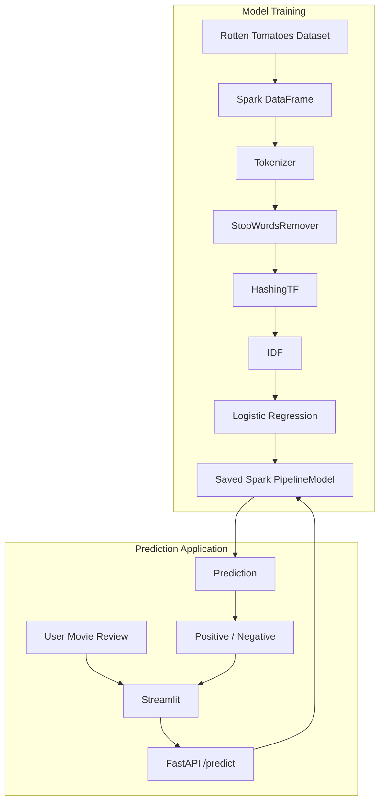

# DATA 226 - Homework 7: Movie Review Sentiment Classifier

## Project Overview

This Homework 7 project builds a movie-review sentiment classifier with Apache Spark ML using the Hugging Face `rotten_tomatoes` dataset. It predicts **Positive** or **Negative** sentiment. FastAPI serves predictions through an API, and Streamlit provides a frontend that sends reviews to that API.

## ML Pipeline

The Spark ML pipeline processes review text through these stages:

```text
Raw text -> Tokenizer -> StopWordsRemover -> HashingTF -> IDF -> LogisticRegression -> Prediction
```

## Project Workflow



`HashingTF` creates term-frequency features and `IDF` weights them, together producing TF-IDF features for logistic regression.

## Project Structure

- `src/train_model.py`: Loads and prepares the dataset, trains and evaluates the pipeline, then saves and tests the model.
- `src/main.py`: Loads the saved Spark `PipelineModel` and serves the `POST /predict` endpoint.
- `src/app.py`: Streamlit interface that sends reviews to the FastAPI backend.
- `spark_mlp_model/`: Saved Spark pipeline model, created by the training script and loaded by the API.
- `requirements.txt`: Python dependencies used by the project.
- `data/raw/` and `data/processed/`: Data directories.
- `logs/`: Project log files.

## Setup

Run these commands from the repository root. Create and activate a virtual environment, then install the dependencies listed in `requirements.txt`:

```powershell
py -m venv .venv
.\.venv\Scripts\Activate.ps1
python -m pip install -r requirements.txt
```

On Windows, local Spark model persistence may require Hadoop's `winutils.exe`. For this setup, it is located at `C:\hadoop\bin\winutils.exe`. Set `HADOOP_HOME` and add its `bin` directory to `PATH` in the PowerShell terminal before running the project:

```powershell
$env:HADOOP_HOME = "C:\hadoop"
$env:PATH = "$env:HADOOP_HOME\bin;$env:PATH"
```

## Running the Project

Run each command from the repository root with the virtual environment activated.

### Train the model

```powershell
python src\train_model.py
```

This loads the dataset, trains and evaluates the Spark ML pipeline, and saves the resulting `PipelineModel` to `spark_mlp_model`.

### Start the FastAPI backend

```powershell
uvicorn src.main:app --reload
```

Open [http://127.0.0.1:8000/docs](http://127.0.0.1:8000/docs) to try the API. The `POST /predict` endpoint accepts a review as the `review` query parameter and returns its sentiment.

### Start the Streamlit frontend

Keep FastAPI running in one terminal. Open another terminal, go to the repository root, activate the same virtual environment, and run:

```powershell
streamlit run src\app.py
```

The Streamlit interface sends reviews to the FastAPI backend at `http://localhost:8000/predict`.

## Model Evaluation

The training script splits the loaded dataset into training and test sets with an 80/20 ratio using `randomSplit([0.8, 0.2], seed=42)`. It evaluates predictions on the test set with Spark's `MulticlassClassificationEvaluator` using the `accuracy` metric. The measured accuracy is printed when training runs and may vary with the data and runtime.

## Example Reviews

**Positive:** "This movie was excellent, emotional, and very enjoyable."

**Negative:** "This movie was boring, confusing, and a complete waste of time."
